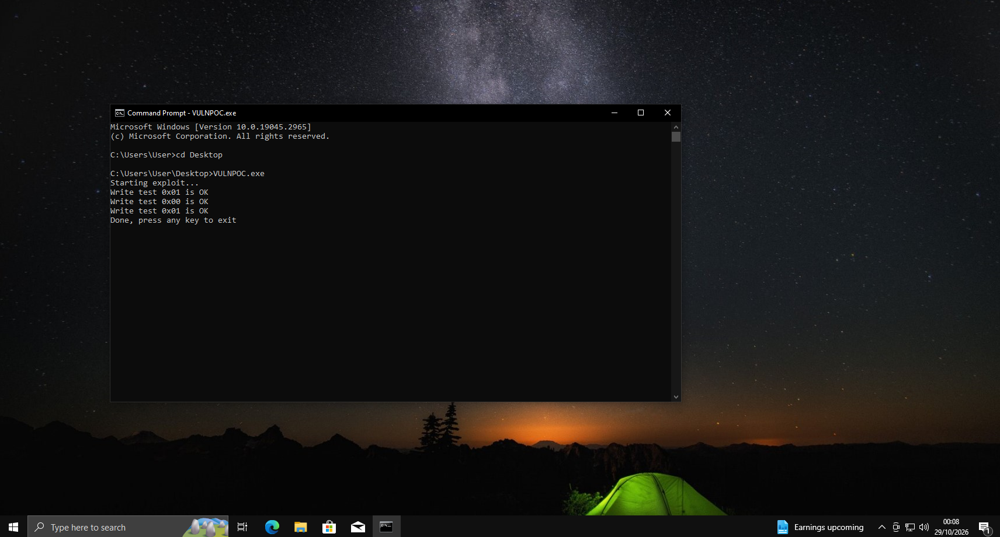

# TunnelVision
nsiproxy.sys vuln to write to fl6t nsi kernel parameters
 
*Just figured out another thing related to networking was also reported under the name TunnelVision back in 2024, not related to this
 
 
**Confirmed as working on Windows 11**

  

